<div align="center">



# Laya (लय)  

**A high-performance, local-first digital painting engine built in Rust, WebAssembly, and modern web technologies.**

[](https://www.gnu.org/licenses/gpl-3.0)
[](https://www.rust-lang.org/)
[](https://webassembly.org/)
[](https://tauri.app/)
[](https://react.dev/)
[](https://tailwindcss.com/)
[]()

<br />

> ⚠️ **IMPORTANT NOTICE: SUPER EARLY ACTIVE DEVELOPMENT (PRE-ALPHA)**
>
> **Laya is in very early, experimental stages of development and is NOT feature-ready for production art or everyday drawing workflows.**
>
> Architectural foundations, brush formats, stroke physics, file serialization, and UI components are actively being prototyped and refined. Breaking changes, incomplete features, and bugs are expected.
>
> We are making this open source early to collaborate with digital artists, graphics engineers, and contributors who are passionate about building a truly fluid, native-grade open painting suite.

</div>

---

## 🌊 The Story & Meaning Behind "Laya"

In Indian classical aesthetics and philosophy, **Laya (लय)** represents the rhythm, tempo, and the sacred state of **absorption into flow**—where the boundary between the drawer, the pencil, and the canvas completely dissolves.

Almost every artist began the same way: sitting on the back bench of a quiet classroom, tuning out the noise, with a pencil wandering freely in the margins of a notebook. You didn't even know what you were drawing—it was pure uninhibited self-discovery through mark-making.

**Laya** is built to honor that pure creative flow.

---

## 🌟 The Vision

Laya combines:
- **Procreate's Fluidity & Simplicity**: Minimalist touch/stylus-first ergonomics, zero-latency stroke feel, gesture navigation, and distraction-free interface.
- **Krita's Artistic Depth**: Advanced brush dynamics (pressure, tilt, speed curves, texture grains), non-destructive layer composition, rich color science (RYB wheels, isoluminant HSY', gamut masks), and Krita brush preset compatibility.
- **Modern Local-First Architecture**: 100% client-side operation with zero cloud/server dependencies, high-performance offline caching, and instantaneous native AppKit desktop drawing.

---

## 🏗️ Dual-Runtime Architecture

A core architectural mandate of Laya is **one single canonical drawing engine** written in pure Rust: **`crates/sketch_core`**.

```
                           ┌───────────────────────────┐
                           │    crates/sketch_core     │
                           │   (Single Canonical Core) │
                           └─────────────┬─────────────┘
                                         │
                    ┌────────────────────┴────────────────────┐
                    ▼                                         ▼
    ┌───────────────────────────────┐         ┌───────────────────────────────┐
    │  WebAssembly Target (Browser) │         │  Native Desktop Target (macOS)│
    │  - Compiled via wasm-pack     │         │  - Native Cocoa / AppKit view │
    │  - Direct Wasm pixel buffer   │         │  - 120Hz/240Hz NSEvent monitor│
    │  - 100% static PWA deployment │         │  - Sub-millisecond latency    │
    └───────────────────────────────┘         └───────────────────────────────┘
```

1. **Single Canonical Core Engine (`crates/sketch_core`)**:
   All dab stamping, blend modes, texture modulation, brush dynamics, and stroke trajectory math live in Rust. There is no duplicate JavaScript drawing implementation.
2. **Native Desktop Overlay (macOS AppKit via Tauri v2)**:
   Draws directly into the Rust framebuffer using a high-frequency native local `NSEvent` monitor and native AppKit view (`drawRect:`), completely bypassing browser event loop latency for true 120Hz/240Hz Apple Pencil / stylus response.
3. **Web / PWA Target**:
   The exact same Rust core compiles to WebAssembly via `wasm-pack` and blits directly to canvas with zero server runtime dependencies.

---

## 🔬 Core Features & Current Status

### ✅ Completed Foundations (Pre-Alpha)
- [x] **Stroke Stabilization & Trajectory Physics**:
  - Pull-string stabilizer with dynamic string contraction when slowing down.
  - Weighted moving-average filter eliminating hand tremor and sensor jitter without sawtooth distortion.
  - Quadratic Bézier subdivision preventing stroke faceting during rapid directional changes.
- [x] **Artistic Color Science**:
  - **Johannes Itten Artist RYB Wheel**: Photometric quantization with configurable sectors and saturation rings.
  - **Classic HSV Barycentric Triangle**: Equilateral triangle mapping with boundary segment clamping.
  - **HSY' Isoluminant Evaluation**: Rec. 709 constant perceived value ($0.2126R + 0.7152G + 0.0722B \equiv Y'$) guaranteeing zero value drift.
  - **Color Harmonies**: Complementary, Split-Complementary, Triadic, Tetradic, and Analogous chord geometry for both RGB and RYB.
  - **Non-Destructive Soft Proofing**: Real-time grayscale tonal evaluation and CMYK pigment print simulation.
- [x] **Brush Engine & Preset Science**:
  - Krita `.kpp` preset parser and resource bundle extractor.
  - GIMP `.gbr` brush tip and `.pat` texture pattern loading.
  - Procedural tip generation with sub-pixel antialiasing and hardness curves.
  - Multi-sensor dynamics (pressure, tilt elevation, velocity, stroke direction).
- [x] **Creative UI Shell**:
  - Procreate-inspired minimalist top navigation bar and floating sidebar rail (brush size, opacity, undo/redo).
  - Floating magnetic tool windows with drag physics, snap resistance, and secondary monitor tear-off.
  - Fluid canvas viewport with spacebar pan, trackpad pinch-to-zoom, exponential focal zoom, and double-click fit.
  - 100% accessible Lucide iconography.
- [x] **Automated Test Coverage**:
  - 320+ unit tests across engine math, raster blending, color spaces, and UI stores running headlessly in Vitest.
  - 66+ Rust unit tests verifying stroke interpolation, brush dynamics, blend modes, and composite stacks.

### 🚧 Actively In Progress & Planned
- [ ] Non-destructive layer stack with grouping, alpha locking, and clipping masks.
- [ ] Origin Private File System (OPFS) and IndexedDB tile caching for instant autosave.
- [ ] Undo/redo history tree with non-destructive tile diffs.
- [ ] Smudge / wet mixer brush engines.
- [ ] Vector inking and procedural pencil engines.
- [ ] Export pipelines (`.sketch`, `.psd`, `.png`, `.webp`, `.kra`).

---

## 📁 Repository Structure

```
├── crates/
│   ├── sketch_core/        # Pure Rust drawing engine (dabs, dynamics, trajectory, composition)
│   └── sketch_native/      # Standalone native AppKit test harness
├── src/
│   ├── engine/             # Headless engine contracts, color science, math, and Wasm bridge
│   ├── input/              # Pointer, stylus, Apple Pencil, and gesture normalization
│   ├── types/              # Stable POD data types and subsystem interface contracts
│   └── ui/                 # React 19 UI shell, floating panels, sliders, and color wheels
├── src-tauri/              # Tauri v2 desktop host, native AppKit overlay, and IPC bridge
└── package.json            # Node workspace scripts and dependencies
```

---

## 🛠️ Prerequisites & Setup

### Prerequisites
- **Node.js**: `v20.x` or later (with `npm` or `pnpm`)
- **Rust**: Latest stable Rust toolchain (2024 edition)
  ```bash
  curl --proto '=https' --tlsv1.2 -sSf https://sh.rustup.rs | sh
  ```
- **wasm-pack**: For compiling the core engine to WebAssembly
  ```bash
  cargo install wasm-pack
  ```
- **macOS Build Tools** (for native desktop): Xcode Command Line Tools (`xcode-select --install`)

### Installation & Development

1. **Clone the repository**:
   ```bash
   git clone https://github.com/Marpuriganesh/laya_app.git
   cd sketch_app
   ```

2. **Install frontend dependencies**:
   ```bash
   npm install
   ```

3. **Compile the Rust core to WebAssembly**:
   ```bash
   npm run build:wasm
   ```

4. **Launch the Web Development Server**:
   ```bash
   npm run dev
   ```
   Open [http://localhost:5173](http://localhost:5173) in your browser.

5. **Launch the Native Desktop App (macOS via Tauri)**:
   ```bash
   npm run tauri dev
   ```

---

## 🧪 Running Tests

The project enforces strict headless unit test coverage for all mathematical formulas, raster operations, and state transitions.

```bash
# Run all TypeScript & engine unit tests (Vitest)
npm test

# Run Rust core drawing engine tests
cargo test --manifest-path crates/sketch_core/Cargo.toml

# Check Cargo workspace compilation
cargo check --manifest-path Cargo.toml
```

---

## 🤝 Contributing

We welcome early contributors, artists, and testers! Whether you want to improve brush dynamics, add new color algorithms, enhance native Cocoa bridges, or report usability issues:

1. Check existing issues or open a discussion describing your idea.
2. Read [`AGENTS.md`](./AGENTS.md) for architectural mandates (especially the rule that all drawing math lives in `crates/sketch_core`).
3. Ensure all automated tests pass (`npm test` and `cargo test`) before opening a pull request.

---

## 📄 License

This project is licensed under the **GNU General Public License v3.0 (GPLv3)**. See the [LICENSE](./LICENSE) file for complete details.

- **For Artists & Creators**: You are 100% free to use Laya for personal and commercial artwork, client projects, and published media with zero royalties or restrictions.
- **For Developers & Companies**: You are free to study, modify, and build upon Laya. Under GPLv3, if you distribute modified versions or derivative applications, you must contribute those modifications back to the community under the same open-source GPLv3 license.
