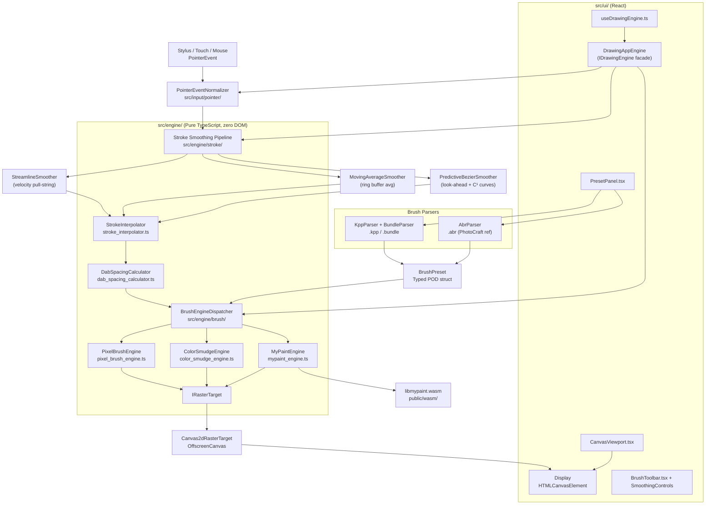

# Phase 1 Spec: Drawing Application — UI Shell, Canvas Setup & Krita/ABR Brush Engine

## Goal & Phasing Strategy

Build the foundational drawing application with a user-first, ergonomic workflow:
1. **Step 1 (First Implementation Target): Procreate-Inspired Minimalist Interface & Photoshop-Style Document Setup**:
   - Deliver a sleek, distraction-free creative interface (Procreate-style top navigation bar, floating vertical brush size/opacity sliders, quick undo/redo, and color disc popover).
   - Provide a Photoshop-style **New Canvas / Document Configuration** system: resolution (custom width × height, presets), DPI, color space (`sRGB`, `Display P3`), and color bit depth (`8-bit`, `16-bit float`).
   - Implement an interactive canvas viewport with smooth centering, pan, and zoom navigation.
2. **Step 2: Stroke Smoothing & Anti-Faceting Pipeline**:
   - Streamline (velocity-adaptive pull-string), Moving Average, and Predictive Bézier look-ahead.
3. **Step 3: Multi-Engine Brush Core with Krita & ABR Compatibility**:
   - Support for Krita `.kpp` presets and `.bundle` archives (Pixel Brush, Color Smudge, MyPaint via WASM).
   - Support for Adobe Photoshop `.abr` brush imports (using clean binary parsing referenced from `storytold/photocraft`).

---

## User Review Required

> [!IMPORTANT]
> **Which Krita brush engines to support in Phase 1?**
> Krita ships ~20 engines. The plan below proposes the **3 high-value engines** that cover the vast majority of Krita brush presets:
> 1. **Pixel Brush** (`paintopid="pixelbrush"` / `"autobrush"`) — standard stamping engine, used by ~70% of all community presets.
> 2. **Color Smudge** (`paintopid="colorsmudge"`) — blending/mixing brushes (impasto, wet oil, watercolor feel).
> 3. **MyPaint** (`paintopid="mypaint"`) — organic/natural media (via `libmypaint` WASM).
>
> **Engines excluded from Phase 1** (complex physics, niche use): Bristle, Chalk, Sketch, Spray, Particle, Dyna, Deform, Hatching, Grid, Clone, Filter, Shape, Curve, Tangent Normal.
> Please confirm this scope or adjust.

> [!IMPORTANT]
> **`libmypaint` WASM: build vs. use pre-built?**
> There is no official npm package for `libmypaint` WASM. Options:
> - **Option A (Recommended):** Use the community port [`eliot-akira/brushlib-wasm`](https://github.com/eliot-akira/brushlib-wasm) as a vendored asset (checked into `public/wasm/`) — no build toolchain needed.
> - **Option B:** Build from the official [`mypaint/libmypaint`](https://github.com/mypaint/libmypaint) C source using Emscripten — adds a native build step to CI.
>
> This plan defaults to **Option A** (vendored) to keep the project 100% statically hostable with no native build dependencies.

> [!WARNING]
> **Krita License:** Krita itself is GPL v3. The engine *implementations* we write in TypeScript are **our own original code** inspired by Krita's documented behavior (public docs, open XML schema). We are not copying Krita C++ source. The only third-party C code brought in is `libmypaint`, which is **LGPL v2.1** — compatible with any license when dynamically linked (WASM is treated as dynamic linking).
> Confirm you are comfortable with this interpretation before proceeding.

---

## Open Questions

> [!IMPORTANT]
> 1. **Canvas resolution strategy**: Fixed-size bitmap (e.g. 2048×2048 px) or infinite/tile-based from Day 1? **Recommendation: fixed-size for Phase 1, tile-based architecture prepared in types.**
>
> 2. **Rendering backend**: Canvas 2D (simple, universal) or WebGL2 (faster compositing)? **Recommendation: Canvas 2D for Phase 1, WebGL2 behind `IRenderer` abstraction for Phase 2.**
>
> 3. **`.kpp` thumbnail display**: Show the 200×200 PNG thumbnail in the preset picker, or just the name?
>
> 4. **Test runner**: Vitest is not yet in `package.json`. OK to add it?
>
> 5. **Default stroke smoothing mode**: Which algorithm should be active when the user first opens the app? Recommendation: **Streamline** (most natural for stylus users), with Moving Average and Predictive Bézier selectable per-brush-preset.
>
> 6. **ABR version support scope**: `.abr` files come in versions 1–2 (Photoshop 6/7, simple) and 6–10 (CS2+, complex 8BIM descriptors + PackBits RLE). Should Phase 1 support all versions or just v6+? **Recommendation: support all (v1–2 is trivial once v6+ works, PhotoCraft's Rust parser covers both).**

---

## Proposed Changes

### Component 1: Project Infrastructure & Contracts
_New contract types, test runner, and dependencies._

---

#### [MODIFY] `package.json`
Add Vitest (headless test runner), JSZip (`.bundle` parsing), fast-xml-parser (`.kpp` XML parsing), and the WASM loader utility.

```diff
+ "vitest": "^1.6.0",
+ "@vitest/coverage-v8": "^1.6.0",
+ "jszip": "^3.10.1",
+ "fast-xml-parser": "^4.4.0"
```

Add test script:
```diff
+ "test": "vitest run",
+ "test:watch": "vitest",
+ "test:coverage": "vitest run --coverage"
```

---

#### [NEW] `src/types/stroke.ts`
Defines the normalized stroke point contract used by all subsystems.

```typescript
/**
 * A single normalized point along a stroke path, carrying all sensor data
 * that hardware can provide: position, pressure, tilt, rotation, and timestamp.
 * This is the universal currency between the Input pipeline and the Brush Engine.
 */
export interface StrokePoint {
  readonly canvasX: number;        // X coordinate in canvas pixel space
  readonly canvasY: number;        // Y coordinate in canvas pixel space
  readonly pressure: number;       // Normalized pressure: 0.0 (none) – 1.0 (full)
  readonly tiltX: number;          // Horizontal tilt in degrees: -90 to +90
  readonly tiltY: number;          // Vertical tilt in degrees: -90 to +90
  readonly rotation: number;       // Barrel rotation in degrees: 0 to 360
  readonly speed: number;          // Stroke speed in pixels/second (computed)
  readonly timeMs: number;         // Timestamp in milliseconds since epoch
}

/**
 * A pair of consecutive StrokePoints forming one interpolatable segment.
 * The brush engine processes strokes as a series of these segments.
 */
export interface StrokeSegment {
  readonly startPoint: StrokePoint;
  readonly endPoint: StrokePoint;
}
```

---

#### [NEW] `src/types/brush.ts`
Defines the brush preset POD contract and dynamics curve schema.

```typescript
/**
 * Maps a sensor input name to a response curve.
 * Mirrors Krita's <curve> XML elements inside a <param>.
 */
export type SensorInputName =
  | "pressure"
  | "tiltX"
  | "tiltY"
  | "speed"
  | "rotation"
  | "random"
  | "distance"
  | "fade";

/**
 * A single control point on a dynamics response curve.
 * Curves are piecewise cubic Bézier defined by an array of these points.
 */
export interface DynamicsCurvePoint {
  readonly inputValue: number;   // 0.0 – 1.0 on the sensor axis
  readonly outputValue: number;  // 0.0 – 1.0 on the parameter axis
}

/**
 * A dynamics mapping: which sensor drives a parameter, and how
 * (via a piecewise Bézier curve).
 */
export interface DynamicsMapping {
  readonly sensorInput: SensorInputName;
  readonly curvePoints: readonly DynamicsCurvePoint[];
  readonly isEnabled: boolean;
}

/**
 * The brush tip definition — either a generated parametric shape
 * or a raster bitmap.
 */
export type BrushTipType = "generated" | "predefined" | "text";

export interface GeneratedBrushTip {
  readonly tipType: "generated";
  readonly diameter: number;          // Diameter in pixels
  readonly hardness: number;          // 0.0 (fully soft) – 1.0 (hard edge)
  readonly aspectRatio: number;       // 1.0 = circle; <1 = squished
  readonly angleRadians: number;      // Tip rotation in radians
}

export interface PredefinedBrushTip {
  readonly tipType: "predefined";
  readonly imageData: Uint8ClampedArray;  // Grayscale 8-bit mask
  readonly width: number;
  readonly height: number;
}

export type BrushTip = GeneratedBrushTip | PredefinedBrushTip;

/**
 * Engine-specific parameter block for the Pixel Brush engine.
 * Directly mirrors the Krita .kpp XML schema for paintopid="pixelbrush".
 */
export interface PixelBrushParameters {
  readonly engineId: "pixelbrush";
  readonly brushTip: BrushTip;
  readonly spacingFraction: number;       // Dab spacing as fraction of brush size
  readonly baseOpacity: number;           // 0.0 – 1.0
  readonly baseFlow: number;              // 0.0 – 1.0
  readonly baseSizePx: number;            // Maximum brush diameter in pixels
  readonly softness: number;              // Tip edge softness 0.0 – 1.0
  readonly scatterAmplitude: number;      // Random dab displacement magnitude
  readonly isAirbrushMode: boolean;       // Spray continuously while held
  readonly sizeDynamics: DynamicsMapping | null;
  readonly opacityDynamics: DynamicsMapping | null;
  readonly angleDynamics: DynamicsMapping | null;
  readonly scatterDynamics: DynamicsMapping | null;
}

/**
 * Engine-specific parameter block for the Color Smudge engine.
 * Mirrors paintopid="colorsmudge".
 */
export interface ColorSmudgeParameters {
  readonly engineId: "colorsmudge";
  readonly brushTip: BrushTip;
  readonly spacingFraction: number;
  readonly baseOpacity: number;
  readonly baseSizePx: number;
  readonly smudgeMode: "smearing" | "dulling";
  readonly colorRate: number;             // 0.0 – 1.0: how much foreground color injects
  readonly smudgeLength: number;          // 0.0 – 1.0: how far smear extends
  readonly smudgeRadius: number;          // In pixels
  readonly sampleAllLayers: boolean;
  readonly sizeDynamics: DynamicsMapping | null;
  readonly opacityDynamics: DynamicsMapping | null;
}

/**
 * Engine-specific parameter block for the MyPaint engine.
 * The actual physics are delegated to the libmypaint WASM module.
 * We store the raw .myb JSON content and the brush name here.
 */
export interface MyPaintParameters {
  readonly engineId: "mypaint";
  readonly mybJsonContent: string;    // Raw JSON string from the .myb brush file
  readonly brushName: string;
}

export type BrushEngineParameters =
  | PixelBrushParameters
  | ColorSmudgeParameters
  | MyPaintParameters;

/**
 * A fully-resolved brush preset ready for the engine to consume.
 * This is the output of the KPP parser and the input to BrushEngine.applyPreset().
 */
export interface BrushPreset {
  readonly presetId: string;            // Unique UUID assigned at load time
  readonly displayName: string;         // Human-readable name from the .kpp file
  readonly thumbnailPngData: Uint8Array; // Raw PNG bytes for UI display
  readonly engineParameters: BrushEngineParameters;
  readonly tags: readonly string[];     // Tags from the bundle manifest
}
```

---

#### [NEW] `src/types/raster.ts`
Canvas surface and pixel buffer contracts.

```typescript
/**
 * A rectangular region of dirty pixels that needs to be re-composited.
 * Used to minimize GPU upload/redraw area after each dab stamp.
 */
export interface DirtyRect {
  readonly x: number;
  readonly y: number;
  readonly width: number;
  readonly height: number;
}

/**
 * Describes a raw pixel buffer in RGBA8 format.
 * This is the fundamental unit of raster data throughout the engine.
 */
export interface PixelBufferDescriptor {
  readonly pixelData: Uint8ClampedArray;  // RGBA8 interleaved
  readonly width: number;
  readonly height: number;
  readonly bytesPerPixel: 4;              // Always 4 for RGBA8
}

/**
 * The raster target contract: the surface that the brush engine writes dabs into.
 * Implementations: MemoryRasterBuffer (headless), WebGPUTexture, OffscreenCanvas.
 * The engine never touches the DOM or GPU directly — only this interface.
 */
export interface IRasterTarget {
  readonly width: number;
  readonly height: number;
  /**
   * Stamps a pre-rendered dab (RGBA8 pixel mask) at the given canvas position.
   * @param dabPixels - RGBA8 pixel data for the dab shape
   * @param targetCenterX - X center of dab in canvas coordinates
   * @param targetCenterY - Y center of dab in canvas coordinates
   * @param dabDiameter - Diameter of the dab in pixels
   */
  blitDab(
    dabPixels: Uint8ClampedArray,
    targetCenterX: number,
    targetCenterY: number,
    dabDiameter: number
  ): DirtyRect;

  /**
   * Reads pixels from the canvas surface (needed for smudge/sampling engines).
   */
  samplePixels(
    x: number,
    y: number,
    width: number,
    height: number
  ): Uint8ClampedArray;
}

/**
 * The blend mode applied when compositing a dab onto the canvas surface.
 * Mirrors Krita's blend mode names for direct preset compatibility.
 */
export type BlendMode =
  | "normal"
  | "multiply"
  | "screen"
  | "overlay"
  | "hardLight"
  | "softLight"
  | "colorDodge"
  | "colorBurn"
  | "darken"
  | "lighten"
  | "difference"
  | "exclusion"
  | "hue"
  | "saturation"
  | "color"
  | "luminosity"
  | "erase";
```

---

#### [NEW] `src/types/engine.ts`
The `IDrawingEngine` facade contract for UI consumption.

```typescript
import type { BrushPreset } from "./brush";
import type { StrokePoint } from "./stroke";

/**
 * The single interface the UI layer uses to interact with the entire engine.
 * All UI components (toolbar, canvas viewport, layer panel) talk to this contract.
 * The concrete DrawingAppEngine class implements this.
 */
export interface IDrawingEngine {
  // --- Canvas Lifecycle ---
  /** Mount the engine to a DOM canvas element (only call from UI layer) */
  mountToCanvas(canvasElement: HTMLCanvasElement): void;
  unmount(): void;

  // --- Brush Preset Management ---
  /** Load a .kpp file (ArrayBuffer from File API) and register the preset */
  loadKritaPreset(kppFileBuffer: ArrayBuffer): Promise<BrushPreset>;
  /** Load a .bundle file (ZIP with many .kpp files) */
  loadKritaBundle(bundleFileBuffer: ArrayBuffer): Promise<readonly BrushPreset[]>;
  /** Set the currently active brush preset */
  setActiveBrush(presetId: string): void;
  /** List all loaded presets */
  getLoadedPresets(): readonly BrushPreset[];

  // --- Active Stroke ---
  /** Called on pointerdown: begin a new stroke */
  beginStroke(point: StrokePoint): void;
  /** Called on pointermove: continue the current stroke */
  extendStroke(point: StrokePoint): void;
  /** Called on pointerup/pointercancel: finalize the stroke */
  endStroke(): void;

  // --- Brush Color ---
  setForegroundColor(r: number, g: number, b: number): void;

  // --- Canvas Settings ---
  setCanvasSize(widthPx: number, heightPx: number): void;
  clearCanvas(): void;
}
```

---

### Component 2: Engine — Math Primitives
_Pure, headless, 1:1 C++ translatable math utilities._

---

#### [NEW] `src/engine/math/vector2d.ts`
2D vector math used throughout stroke interpolation.

```typescript
/** Immutable 2D vector — all operations return new values, no mutation. */
export interface Vector2D { readonly x: number; readonly y: number; }

/** Compute Euclidean distance between two 2D points. */
export function computeDistance(pointA: Vector2D, pointB: Vector2D): number { ... }

/** Linear interpolation between two vectors at ratio t (0..1). */
export function interpolateLinear(from: Vector2D, to: Vector2D, t: number): Vector2D { ... }

/** Catmull-Rom spline interpolation for smooth stroke paths. */
export function interpolateCatmullRom(p0: Vector2D, p1: Vector2D, p2: Vector2D, p3: Vector2D, t: number): Vector2D { ... }
```

#### [NEW] `src/engine/math/dynamics_curve.ts`
Evaluates Krita-style piecewise Bézier dynamics curves.

```typescript
/**
 * Evaluates a piecewise linear dynamics mapping curve at a given sensor input.
 * Krita stores curves as sorted control points; we do linear segment lookup.
 * Future: upgrade to cubic Bézier for exact Krita curve fidelity.
 */
export function evaluateDynamicsCurve(
  curvePoints: readonly DynamicsCurvePoint[],
  sensorInputValue: number  // 0.0 – 1.0
): number { ... }  // Returns 0.0 – 1.0 output
```

---

### Component 3: Engine — Krita Preset Parser
_Parses `.kpp` and `.bundle` files in the browser. Zero DOM dependency._

---

#### [NEW] `src/engine/brush/kpp_parser.ts`
Extracts XML from `.kpp` PNG metadata chunks and deserializes to `BrushPreset`.

```
KPP File (PNG bytes)
  → extractPngTextChunk(bytes, keyword="Preset")  → XML string
  → parsePresetXml(xmlString)                     → raw param map
  → buildBrushPreset(paramMap)                    → BrushPreset
```

Key parsing logic:
- Read PNG chunks byte-by-byte (no browser DOM image needed — pure `Uint8Array` manipulation).
- Find `tEXt` / `zTXt` chunk with keyword `"Preset"`.
- Decompress with DecompressionStream (Compression Streams API, supported in all modern browsers).
- Parse with `fast-xml-parser`.
- Dispatch on `paintopid` attribute to build typed `BrushEngineParameters`.

#### [NEW] `src/engine/brush/bundle_parser.ts`
Unzips `.bundle` (ZIP) and extracts all contained `.kpp` files.

```typescript
// Uses JSZip in the browser
export async function parseKritaBundle(
  bundleArrayBuffer: ArrayBuffer
): Promise<readonly BrushPreset[]>
```

---

### Component 3.5: Engine — ABR Brush Importer (Adobe Photoshop Brushes)

---

#### [NEW] `src/engine/brush/abr_parser.ts`
Parses Adobe Photoshop `.abr` brush files natively in the browser using `DataView` (big-endian binary parsing, no native bindings needed).

**Reference**: The binary format specification is derived from:
- [`storytold/photocraft`](https://github.com/storytold/photocraft) (Rust) — clean-room Rust implementation of ABR parsing covering modern descriptor-based formats.
- [`jlai/brush-viewer`](https://github.com/jlai/brush-viewer) — Kaitai Struct `.ksy` schema for ABR versions 6–10 in JavaScript.
- Adobe's partially-documented 8BIM block format.

> [!NOTE]
> **PhotoCraft** is an open-source Rust photo editor by `storytold`. Its ABR parser is written in pure Rust with no OS dependencies — the binary parsing logic maps 1:1 to TypeScript `DataView` operations. We use it purely as a format reference, not as a compiled dependency.

**Format versions supported:**

| Version | Photoshop Era | Format |
|---------|--------------|--------|
| 1–2 | PS 6, PS 7 | Simple header + raw pixel planes |
| 6 | PS CS2–CS6 | 8BIM blocks + Action Descriptors |
| 7–10 | PS CC+ | 8BIM + extended descriptor tables |

**Parsing pipeline:**
```
ABR ArrayBuffer
  → readAbrHeader()          → { majorVersion, minorVersion }
  → dispatchVersionParser()
      → v1/v2: parseLegacyBrushRecord()   → BrushTipBitmap[]
      → v6+:   read8BimBlocks()
                → parseSampBlock()         → PackBits RLE decode → BrushTipBitmap
                → parseDescBlock()         → BrushDynamics (size, opacity, scatter curves)
  → buildBrushPresetFromAbr()             → BrushPreset (same contract as .kpp)
```

**PackBits RLE decompression** (used for brush tip pixel data in v6+):
```
// Standard PackBits algorithm (same as TIFF/PSD):
// byte > 0:  copy next (byte+1) bytes literally
// byte < 0:  repeat next byte (-byte+1) times
// byte = -128: no-op
```

The output is a standard `BrushPreset` with a `PredefinedBrushTip` (the decoded grayscale alpha mask). Since ABR presets don't carry the rich dynamics XML that `.kpp` files have, dynamics default to linear pressure→size mapping with no other curves.

```typescript
export async function parseAbrFile(
  abrArrayBuffer: ArrayBuffer
): Promise<readonly BrushPreset[]>
```

#### [NEW] `src/engine/brush/__tests__/abr_parser.test.ts`
- Parse a real ABR v1/v2 fixture and verify brush count and tip dimensions.
- Parse a real ABR v6+ fixture and verify 8BIM block traversal and PackBits decompression.
- Verify output conforms to `BrushPreset` contract (same as KPP output).

---

### Component 4: Engine — Brush Engines (TypeScript implementations)
_Pure dab-generation algorithms. No DOM/Canvas access. All I/O through IRasterTarget._

---

#### [NEW] `src/engine/brush/pixel_brush_engine.ts`
Implements Krita's Pixel Brush Engine logic:
- Compute dab positions along a stroke segment using spacing + leftover distance accumulation.
- Evaluate dynamics curves (size, opacity, angle, scatter) from sensor inputs.
- Generate a dab mask (`Uint8ClampedArray`) for a given radius/hardness using the **Gaussian falloff formula**: `alpha(r) = exp(-(r/sigma)^2)` for soft brushes, 1.0 for hard brushes.
- Call `IRasterTarget.blitDab()` — never writes to canvas directly.

#### [NEW] `src/engine/brush/color_smudge_engine.ts`
Implements Krita's Color Smudge Engine:
- Samples pixels from `IRasterTarget.samplePixels()` around the dab position.
- Mixes sampled color with foreground color per `colorRate` and `smudgeMode`.
- Writes blended dab back via `IRasterTarget.blitDab()`.

#### [NEW] `src/engine/brush/mypaint_engine.ts`
Thin adapter for `libmypaint` WASM:
- Loads the WASM module lazily on first use.
- Wraps `mypaint_brush_stroke_to()` C call.
- Translates `StrokePoint` sensor data into MyPaint's parameter space.
- Receives dab callbacks from the WASM surface and forwards to `IRasterTarget`.

```typescript
export interface MyPaintWasmModule {
  createBrush(): number;                              // Opaque handle
  loadBrushJson(handle: number, jsonString: string): void;
  strokeTo(handle: number, x: number, y: number, pressure: number,
           tiltX: number, tiltY: number, dtime: number): void;
  destroyBrush(handle: number): void;
}
```

#### [NEW] `src/engine/brush/brush_engine_dispatcher.ts`
Routes `StrokePoint` events to the correct engine implementation based on the active `BrushPreset`.

```typescript
export function dispatchStrokePoint(
  point: StrokePoint,
  preset: BrushPreset,
  rasterTarget: IRasterTarget,
  foregroundColor: RgbaColor
): DirtyRect
```

---

### Component 5: Engine — Raster Target Implementations

---

#### [NEW] `src/engine/raster/memory_raster_buffer.ts`
Headless in-memory `IRasterTarget` implementation for unit tests.
- Backed by a plain `Uint8ClampedArray`.
- `blitDab()` performs per-pixel RGBA blending (Normal blend mode).
- No DOM, no canvas, no WebGL.

#### [NEW] `src/engine/raster/canvas2d_raster_target.ts`
Production `IRasterTarget` backed by an HTML5 OffscreenCanvas.
- Lives in the Renderer layer; the engine never references this directly.
- Accessed through the `IRasterTarget` contract.

---

### Component 6: Engine — Stroke Processor + Smoothing Pipeline

The stroke processor sits between raw pointer events and the brush engine. It handles three responsibilities in sequence: **smoothing** (clean up raw jittery input), **interpolation** (fill gaps between events), and **dab spacing** (decide exactly where to stamp).

---

#### [NEW] `src/engine/stroke/stroke_smoother.ts`
Defines the `IStrokeSmoother` contract and the three concrete smoothing algorithm implementations. All algorithms operate on `StrokePoint[]` and return a smoothed `StrokePoint[]`.

```typescript
/**
 * Selectable stroke smoothing algorithm.
 * Each mode is independently configurable per brush preset.
 */
export type SmoothingMode = "streamline" | "movingAverage" | "predictiveBezier" | "none";

export interface StrokeSmoothingConfig {
  readonly mode: SmoothingMode;
  /** Streamline: string length in pixels (max lag distance). 1–150. Default: 20. */
  readonly streamlineStringRadiusPx: number;
  /** Streamline: base smoothing lerp factor at zero velocity. 0..1. Default: 0.1. */
  readonly streamlineBaseSmoothing: number;
  /** Streamline: lerp factor at max velocity. 0..1. Default: 0.9. */
  readonly streamlineMaxSmoothing: number;
  /** Streamline: speed (px/s) at which smoothing reaches maximum. Default: 400. */
  readonly streamlineVelocityThresholdPxPerSec: number;
  /** Moving Average: how many past points to average. 2–20. Default: 6. */
  readonly movingAverageWindowSize: number;
  /** Predictive Bézier: how many frames ahead to predict. 1–4. Default: 2. */
  readonly predictiveLookAheadFrames: number;
}

/** Contract: a smoother takes a new raw point + mutable state and returns a smoothed point. */
export interface IStrokeSmoother {
  readonly mode: SmoothingMode;
  beginStroke(firstPoint: StrokePoint): StrokePoint;
  smooth(rawPoint: StrokePoint, elapsedMs: number): StrokePoint;
  endStroke(): void;
}
```

---

#### [NEW] `src/engine/stroke/streamline_smoother.ts`
**Algorithm: Velocity-Adaptive Pull-String (Streamline)**

Inspired by Clip Studio Paint's "Stabilize" and the classic pull-string/rope model. The drawing anchor (`anchorPoint`) trails behind the physical stylus position (`pointerPoint`) by up to `stringRadiusPx` pixels, creating a natural string-lag effect. The pull rate is modulated by the current stroke velocity — fast strokes get more drag (higher smoothing), slow strokes almost no drag (low latency for precise details).

Both **position** and **pressure** are smoothed independently.

```
Math:
  velocity (px/s) = distance(pointer, lastPointer) / deltaTimeSec
  velocityFactor  = clamp(velocity / velocityThreshold, 0, 1)
  lerpFactor      = mix(baseSmoothing, maxSmoothing, velocityFactor)

  // Pull-string constraint: keep anchor within stringRadius of pointer
  if distance(anchor, pointer) > stringRadius:
    direction  = normalize(pointer - anchor)
    anchor.pos = pointer - direction * stringRadius

  // Exponential smoothing toward pointer
  anchor.x += (pointer.x - anchor.x) * lerpFactor
  anchor.y += (pointer.y - anchor.y) * lerpFactor

  // Pressure smoothing (EMA with fixed 0.25 factor — fast enough for pressure spikes)
  anchor.pressure += (pointer.pressure - anchor.pressure) * 0.25
```

Key properties:
- **Zero visual lag at stroke start** — anchor snaps to pointer on `beginStroke()`.
- **Velocity-aware**: at rest/slow speed → minimal lag (accurate corners); at high speed → maximum smoothing (clean fast sweeps).
- **Pressure also smoothed** — eliminates erratic width spikes from noisy stylus hardware.

---

#### [NEW] `src/engine/stroke/moving_average_smoother.ts`
**Algorithm: Sliding Window Moving Average**

Maintains a ring buffer of the last `windowSize` raw `StrokePoint`s. Each frame, returns the arithmetic mean of all buffered points' (x, y, pressure) values. Simple, predictable, and good for uniform tremor suppression.

```
Math:
  smoothedX = (1/N) * Σ(points[i].canvasX)    for i in [0..N-1]
  smoothedY = (1/N) * Σ(points[i].canvasY)
  smoothedPressure = (1/N) * Σ(points[i].pressure)
```

Characteristics:
- Introduces a spatial lag proportional to `windowSize × event frequency`.
- Best used at small window sizes (3–6) to minimize lag.
- Uniform smoothing independent of velocity — good for hatching and controlled linework.

---

#### [NEW] `src/engine/stroke/predictive_bezier_smoother.ts`
**Algorithm: Predictive Look-Ahead Bézier (Anti-Faceting)**

Solves **faceting** — the jagged angular appearance that occurs when discrete pointer events at low sampling rates are joined by straight line segments, especially visible at mid-stroke speeds.

**Two-stage approach:**

**Stage 1 — Look-ahead extrapolation (prediction):**
Uses the velocity and acceleration of the last 3 points to predict where the stylus will be `lookAheadFrames` frames in the future. This predicted point is temporarily appended to the point buffer, causing the curve fitter to "aim ahead" of the current stylus position — masking event latency.

```
// Finite-difference velocity and acceleration from last 3 points
velocity     = (p[n] - p[n-1]) / dt
acceleration = (p[n] - 2*p[n-1] + p[n-2]) / dt^2

// Predicted next point
predictedPoint = p[n] + velocity * lookAheadDt + 0.5 * acceleration * lookAheadDt^2
```

**Stage 2 — Catmull-Rom → Cubic Bézier conversion:**
Converts the smoothed + predicted point buffer into a cubic Bézier path using the standard Catmull-Rom tangent formula, giving mathematically smooth C¹ continuity across all segment joints:

```
// Control points for segment P[i] → P[i+1]:
C1 = P[i]   + (P[i+1] - P[i-1]) / 6
C2 = P[i+1] - (P[i+2] - P[i])   / 6
```

The result is a stream of `CubicBezierSegment` values (not `StrokePoint[]`) that the dab spacing calculator evaluates using De Casteljau's algorithm.

```typescript
export interface CubicBezierSegment {
  readonly p0: Vector2D;   // Start anchor
  readonly c1: Vector2D;   // First control point
  readonly c2: Vector2D;   // Second control point
  readonly p3: Vector2D;   // End anchor
  readonly startPressure: number;
  readonly endPressure: number;
  readonly startTimeMs: number;
  readonly endTimeMs: number;
}
```

> [!NOTE]
> **Why Predictive Bézier is the right fix for faceting**: Catmull-Rom/Moving Average smooth along the *past* path but still commit to straight chord segments between output points — faceting remains at macro scales. The Bézier stage replaces all chords with curves, completely eliminating the polygon-line artifact regardless of event rate.

---

#### [NEW] `src/engine/stroke/stroke_interpolator.ts`
Orchestrates the smoother → curve fitter pipeline:
- Receives raw `StrokePoint` from the input normalizer.
- Passes it through the active `IStrokeSmoother`.
- Computes stroke speed (px/s) from timestamps.
- Outputs either `StrokePoint[]` (for Streamline/Moving Average) or `CubicBezierSegment[]` (for Predictive Bézier) to the dab spacing calculator.

#### [NEW] `src/engine/stroke/dab_spacing_calculator.ts`
- Tracks `leftoverDistancePx` between pointer events.
- For straight paths: linear interpolation at `spacingFraction × brushDiameter` intervals.
- For Bézier paths: arc-length parameterization using De Casteljau evaluation at equal-arc intervals.
- Zero stateful globals — all state passed in/out explicitly.

---

### Component 7: Input Pipeline

---

#### [NEW] `src/input/pointer/pointer_event_normalizer.ts`
- Listens to `pointerdown`, `pointermove`, `pointerup`, `pointercancel`.
- Extracts `pressure`, `tiltX`, `tiltY`, `twist` from `PointerEvent`.
- Normalizes coordinates to canvas pixel space (accounts for device pixel ratio).
- Calls `IDrawingEngine.beginStroke()` / `extendStroke()` / `endStroke()`.

---

### Component 8: Engine Facade

---

#### [NEW] `src/engine/drawing_app_engine.ts`
The concrete `DrawingAppEngine` implementing `IDrawingEngine`:
- Owns a `BrushEngineDispatcher`, `StrokeInterpolator`, `Canvas2dRasterTarget`.
- `mountToCanvas()` creates the Canvas 2D raster target and attaches the pointer normalizer.
- `loadKritaPreset()` / `loadKritaBundle()` delegate to the parsers.
- Routes all `beginStroke`, `extendStroke`, `endStroke` calls through the interpolator → dispatcher pipeline.

---

### Component 9: UI — Procreate-Style Interface Shell & Photoshop-Style Document Setup

The UI is built using React, Tailwind CSS, and `lucide-react` icons. It provides a distraction-free, touch/stylus-first digital painting workspace resembling Procreate, coupled with Photoshop's professional document resolution and color space setup.

---

#### [NEW] `src/types/document.ts`
Document configuration contract for resolution, DPI, color space, and bit depth.

```typescript
export type ColorSpace = "srgb" | "display-p3";
export type BitDepth = "8-bit" | "16-bit-float";
export type CanvasUnit = "pixels" | "inches" | "cm" | "mm";

export interface DocumentConfiguration {
  readonly id: string;
  readonly title: string;
  readonly width: number;                // In pixels
  readonly height: number;               // In pixels
  readonly dpi: number;                  // Standard DPI (72, 144, 300)
  readonly colorSpace: ColorSpace;       // sRGB or Display P3
  readonly bitDepth: BitDepth;           // 8-bit standard or 16-bit float
  readonly backgroundColor: string;      // Hex or 'transparent'
}

export interface DocumentPreset {
  readonly name: string;
  readonly width: number;
  readonly height: number;
  readonly dpi: number;
  readonly category: "Screen" | "Print" | "Square" | "Video";
}

export const STANDARD_DOCUMENT_PRESETS: readonly DocumentPreset[] = [
  { name: "Screen Size", width: 1920, height: 1080, dpi: 72, category: "Screen" },
  { name: "Square 2K", width: 2048, height: 2048, dpi: 144, category: "Square" },
  { name: "4K UHD", width: 3840, height: 2160, dpi: 72, category: "Video" },
  { name: "A4 Document", width: 2480, height: 3508, dpi: 300, category: "Print" },
  { name: "Standard 4K Square", width: 4096, height: 4096, dpi: 300, category: "Square" },
];
```

---

#### [NEW] `src/ui/components/NewCanvasModal.tsx`
Photoshop-style dialog for creating a new document or editing current document parameters:
- **Preset Quick Picks**: Screen Size, Square 2K, 4K UHD, A4 Print.
- **Custom Dimension Inputs**: Width & Height with unit switcher (px, in, cm, mm).
- **Resolution**: DPI input (72 web, 144 retina, 300 print).
- **Color Settings**: Color profile dropdown (`sRGB IEC61966-2.1`, `Display P3 (Wide Gamut)`) and Color depth (`8-bit / Channel`, `16-bit Float / Channel`).
- **Background Contents**: White, Transparent, Black, Custom.
- Modal animations and keyboard shortcuts (`Enter` to create, `Esc` to close).

---

#### [NEW] `src/ui/components/TopNavBar.tsx`
Procreate-style sleek, minimalist dark top bar:
- **Left Control Cluster**:
  - `Gallery / New Canvas` button (triggers `NewCanvasModal`).
  - `Actions` (Wrench icon) for Document properties, canvas flip, clear, export.
  - `Adjustments` (Wand icon) for future blur/hue filters.
  - `Select` (Ribbon icon) & `Transform` (Cursor arrow icon).
- **Center Document Info**:
  - Document Title & Canvas Zoom percentage indicator (e.g. `100%`, `Fit`).
- **Right Active Tool Cluster**:
  - **Paint (Brush)** tool button (`Paintbrush` icon) — toggles Brush Library popover when clicked again.
  - **Smudge** tool button (`Hand` or `Fingerprint` icon) — activates Color Smudge engine.
  - **Eraser** tool button (`Eraser` icon) — activates erase blend mode.
  - **Layers** button (`Layers` icon) — indicator for layer count.
  - **Active Color Swatch Pill** — circular color swatch opening the Color Picker popover.

---

#### [NEW] `src/ui/components/SidebarRail.tsx`
Procreate-style ergonomic vertical floating rail (dockable to left or right):
- **Size Slider**: Vertical sleek slider controlling active brush size (1px – 500px) with numeric bubble indicator on drag.
- **Opacity Slider**: Vertical slider controlling active stroke opacity (1% – 100%) with percentage bubble.
- **Undo Button** (`Undo2` icon) & **Redo Button** (`Redo2` icon) with click and continuous press handling.
- Minimalist semi-transparent pill container with glassmorphism backdrop blur.

---

#### [NEW] `src/ui/components/ColorPickerPopover.tsx`
Floating color picker popover:
- HSV Color Wheel / Ring (Hue angle 0–360°).
- Inner Saturation/Value 2D gradient square.
- Hex / RGB input fields.
- Current vs. Previous color comparison swatch.
- Quick palette row (recent colors).

---

#### [NEW] `src/ui/components/BrushLibraryPopover.tsx`
Floating brush library modal:
- Category list (Sketching, Inking, Painting, Airbrush, Textures, Imported).
- Presets grid showing brush name, engine tag (Pixel, Smudge, MyPaint, ABR), and thumbnail preview.
- Quick buttons to "Import .kpp / .bundle" (Krita) and "Import .abr" (Photoshop).

---

#### [NEW] `src/ui/components/CanvasViewport.tsx`
Interactive canvas viewport container:
- Centered document artboard rendered with subtle drop shadow against a neutral workspace backdrop (`#18181b`).
- Smooth pan & zoom navigation (wheel zoom, middle-click/space-drag pan).
- Renders the primary raster `<canvas>` matching the `DocumentConfiguration` pixel dimensions.
- High-DPI screen backing buffer scaling.

---

#### [MODIFY] `src/App.tsx`
Root workspace combining `TopNavBar`, `SidebarRail`, `CanvasViewport`, `NewCanvasModal`, `ColorPickerPopover`, and `BrushLibraryPopover` with cohesive state management.

---

#### [NEW] `src/ui/hooks/useDocumentStore.ts`
Document state management:
- Active `DocumentConfiguration` (dimensions, DPI, color space).
- Active tool (`brush` | `smudge` | `eraser`).
- Active color (`#000000` / RGBA).
- Brush size (`px`) and brush opacity (`0..1`).
- Zoom scale and pan offset.
- Modal open/closed states.

---

### Component 10: WASM Asset

---

#### [NEW] `public/wasm/libmypaint.wasm`  _(vendored binary)_
#### [NEW] `public/wasm/libmypaint.js`   _(Emscripten JS glue, vendored)_

From `eliot-akira/brushlib-wasm` (LGPL v2.1). Checked in as static assets.
Loaded lazily by `mypaint_engine.ts` via `fetch('/wasm/libmypaint.js')` — works offline via Service Worker.

---

### Component 11: Tests

---

#### [NEW] `src/engine/math/__tests__/vector2d.test.ts`
Verify distance, interpolation, Catmull-Rom boundary values.

#### [NEW] `src/engine/math/__tests__/dynamics_curve.test.ts`
Verify curve evaluation at `t=0`, `t=1`, midpoint, and out-of-range clamp.

#### [NEW] `src/engine/brush/__tests__/kpp_parser.test.ts`
Use a real `.kpp` fixture file (committed to `src/engine/brush/__fixtures__/`) and verify:
- Correct `paintopid` extraction.
- Correct `baseSizePx`, `baseOpacity`, `spacingFraction` values.
- Correct `thumbnailPngData` extraction.

#### [NEW] `src/engine/brush/__tests__/pixel_brush_engine.test.ts`
Using a `MemoryRasterBuffer` mock target:
- Verify dab count for a known stroke distance and spacing.
- Verify pressure → size mapping with a linear dynamics curve.
- Verify scatter does not place dabs outside canvas bounds.

#### [NEW] `src/engine/stroke/__tests__/dab_spacing_calculator.test.ts`
- Verify correct dab count for a 100px stroke with 10px spacing.
- Verify leftover distance accumulates correctly across segments.
- Verify edge case: stroke shorter than one spacing step emits zero or one dab.

#### [NEW] `src/engine/raster/__tests__/memory_raster_buffer.test.ts`
- Verify `blitDab` writes to the correct pixel coordinates.
- Verify RGBA alpha blending formula (Normal mode).
- Verify boundary clamping when dab center is near canvas edge.

---

## Architecture Diagram



---

## File Map Summary

```
src/
├── types/
│   ├── stroke.ts       [NEW] StrokePoint, StrokeSegment, CubicBezierSegment
│   ├── brush.ts        [NEW] BrushPreset, BrushEngineParameters, DynamicsMapping
│   ├── raster.ts       [NEW] IRasterTarget, DirtyRect, BlendMode
│   └── engine.ts       [NEW] IDrawingEngine facade interface
│
├── engine/
│   ├── math/
│   │   ├── vector2d.ts                              [NEW]
│   │   ├── dynamics_curve.ts                        [NEW]
│   │   └── __tests__/
│   │       ├── vector2d.test.ts                     [NEW]
│   │       └── dynamics_curve.test.ts               [NEW]
│   ├── stroke/
│   │   ├── stroke_smoother.ts                       [NEW] IStrokeSmoother contract + config types
│   │   ├── streamline_smoother.ts                   [NEW] Velocity-adaptive pull-string
│   │   ├── moving_average_smoother.ts               [NEW] Sliding window average
│   │   ├── predictive_bezier_smoother.ts            [NEW] Look-ahead + Catmull-Rom→Bézier
│   │   ├── stroke_interpolator.ts                   [NEW] Pipeline orchestrator
│   │   ├── dab_spacing_calculator.ts                [NEW] Linear + arc-length Bézier spacing
│   │   └── __tests__/
│   │       ├── streamline_smoother.test.ts          [NEW]
│   │       ├── moving_average_smoother.test.ts      [NEW]
│   │       ├── predictive_bezier_smoother.test.ts   [NEW]
│   │       └── dab_spacing_calculator.test.ts       [NEW]
│   ├── brush/
│   │   ├── kpp_parser.ts                            [NEW] .kpp PNG chunk parser
│   │   ├── bundle_parser.ts                         [NEW] .bundle ZIP extractor
│   │   ├── abr_parser.ts                            [NEW] .abr v1-2 + v6-10 binary parser
│   │   ├── pixel_brush_engine.ts                    [NEW]
│   │   ├── color_smudge_engine.ts                   [NEW]
│   │   ├── mypaint_engine.ts                        [NEW] libmypaint WASM adapter
│   │   ├── brush_engine_dispatcher.ts               [NEW]
│   │   ├── __fixtures__/
│   │   │   ├── sample.kpp                           [NEW] Krita preset test fixture
│   │   │   ├── sample_v2.abr                        [NEW] ABR v2 test fixture
│   │   │   └── sample_v6.abr                        [NEW] ABR v6 test fixture
│   │   └── __tests__/
│   │       ├── kpp_parser.test.ts                   [NEW]
│   │       ├── abr_parser.test.ts                   [NEW]
│   │       └── pixel_brush_engine.test.ts           [NEW]
│   ├── raster/
│   │   ├── memory_raster_buffer.ts                  [NEW] Headless IRasterTarget
│   │   ├── canvas2d_raster_target.ts                [NEW] OffscreenCanvas production target
│   │   └── __tests__/
│   │       └── memory_raster_buffer.test.ts         [NEW]
│   └── drawing_app_engine.ts                        [NEW] IDrawingEngine implementation
│
├── input/
## File Map Summary

```
src/
├── types/
│   ├── document.ts                              [NEW] DocumentConfiguration, Presets, ColorSpace, BitDepth
│   ├── stroke.ts                                [NEW] StrokePoint, StrokeSegment, CubicBezierSegment
│   ├── brush.ts                                 [NEW] BrushPreset, BrushEngineParameters, DynamicsMapping
│   ├── raster.ts                                [NEW] IRasterTarget, DirtyRect, BlendMode
│   └── engine.ts                                [NEW] IDrawingEngine facade interface
│
├── ui/
│   ├── components/
│   │   ├── TopNavBar.tsx                        [NEW] Procreate minimalist header & tools
│   │   ├── SidebarRail.tsx                      [NEW] Procreate vertical size/opacity sliders + undo/redo
│   │   ├── CanvasViewport.tsx                   [NEW] Pan/zoom centered canvas artboard
│   │   ├── NewCanvasModal.tsx                   [NEW] Photoshop resolution/color space dialog
│   │   ├── ColorPickerPopover.tsx               [NEW] HSV disc + saturation/value box
│   │   └── BrushLibraryPopover.tsx              [NEW] Categorized brushes & import triggers
│   └── hooks/
│       ├── useDocumentStore.ts                  [NEW] Document & UI reactive state
│       └── useDrawingEngine.ts                  [NEW] Engine integration hook
│
├── engine/
│   ├── math/
│   │   ├── vector2d.ts                          [NEW]
│   │   ├── dynamics_curve.ts                    [NEW]
│   │   └── __tests__/
│   │       ├── vector2d.test.ts                 [NEW]
│   │       └── dynamics_curve.test.ts           [NEW]
│   ├── stroke/
│   │   ├── stroke_smoother.ts                   [NEW] IStrokeSmoother contract + config types
│   │   ├── streamline_smoother.ts               [NEW] Velocity-adaptive pull-string
│   │   ├── moving_average_smoother.ts           [NEW] Sliding window average
│   │   ├── predictive_bezier_smoother.ts        [NEW] Look-ahead + Catmull-Rom→Bézier
│   │   ├── stroke_interpolator.ts               [NEW] Pipeline orchestrator
│   │   ├── dab_spacing_calculator.ts            [NEW] Linear + arc-length Bézier spacing
│   │   └── __tests__/
│   │       ├── streamline_smoother.test.ts      [NEW]
│   │       ├── moving_average_smoother.test.ts  [NEW]
│   │       ├── predictive_bezier_smoother.test.ts [NEW]
│   │       └── dab_spacing_calculator.test.ts   [NEW]
│   ├── brush/
│   │   ├── kpp_parser.ts                        [NEW] .kpp PNG chunk parser
│   │   ├── bundle_parser.ts                     [NEW] .bundle ZIP extractor
│   │   ├── abr_parser.ts                        [NEW] .abr v1-2 + v6-10 binary parser
│   │   ├── pixel_brush_engine.ts                [NEW]
│   │   ├── color_smudge_engine.ts               [NEW]
│   │   ├── mypaint_engine.ts                    [NEW] libmypaint WASM adapter
│   │   ├── brush_engine_dispatcher.ts           [NEW]
│   │   ├── __fixtures__/
│   │   │   ├── sample.kpp                       [NEW] Krita preset test fixture
│   │   │   ├── sample_v2.abr                    [NEW] ABR v2 test fixture
│   │   │   └── sample_v6.abr                    [NEW] ABR v6 test fixture
│   │   └── __tests__/
│   │       ├── kpp_parser.test.ts               [NEW]
│   │       ├── abr_parser.test.ts               [NEW]
│   │       └── pixel_brush_engine.test.ts       [NEW]
│   ├── raster/
│   │   ├── memory_raster_buffer.ts              [NEW] Headless IRasterTarget
│   │   ├── canvas2d_raster_target.ts            [NEW] OffscreenCanvas production target
│   │   └── __tests__/
│   │       └── memory_raster_buffer.test.ts     [NEW]
│   └── drawing_app_engine.ts                    [NEW] IDrawingEngine implementation
│
├── input/
│   └── pointer/
│       └── pointer_event_normalizer.ts          [NEW]
│
public/
└── wasm/
    ├── libmypaint.wasm                          [NEW] (vendored LGPL binary)
    └── libmypaint.js                            [NEW] (Emscripten glue)
```

---

### Component 11: Tests

---

#### [NEW] `src/engine/math/__tests__/vector2d.test.ts`
Verify distance, interpolation, Catmull-Rom boundary values (t=0, t=1, midpoint).

#### [NEW] `src/engine/math/__tests__/dynamics_curve.test.ts`
Verify curve evaluation at `t=0`, `t=1`, midpoint, and out-of-range clamp.

#### [NEW] `src/engine/stroke/__tests__/streamline_smoother.test.ts`
- Verify anchor snaps to pointer at `beginStroke()` (zero lag at start).
- Verify at low velocity: output closely tracks input (low damping).
- Verify at high velocity: output lags behind input by up to `stringRadius`.
- Verify pressure EMA: noisy pressure input → smooth output trend.

#### [NEW] `src/engine/stroke/__tests__/moving_average_smoother.test.ts`
- Verify window of size N averages last N points correctly.
- Verify first N-1 points (before window is full) return partial average.
- Verify a spike in one frame is dampened by the window.

#### [NEW] `src/engine/stroke/__tests__/predictive_bezier_smoother.test.ts`
- Verify a straight-line stroke produces collinear control points (no artifact curves).
- Verify a curved stroke produces C¹ continuous tangents at knot joints.
- Verify predictive extrapolation reduces visible lag on a constant-velocity stroke.
- Verify `CubicBezierSegment` output conforms to the contract type.

#### [NEW] `src/engine/stroke/__tests__/dab_spacing_calculator.test.ts`
- Linear path: verify correct dab count for a 100px stroke with 10px spacing.
- Bézier path: verify equal arc-length spacing on a known quarter-circle curve.
- Verify leftover distance accumulates correctly across events.
- Edge case: stroke shorter than one spacing step emits zero or one dab.

#### [NEW] `src/engine/brush/__tests__/kpp_parser.test.ts`
Use a real `.kpp` fixture:
- Correct `paintopid` extraction.
- Correct `baseSizePx`, `baseOpacity`, `spacingFraction` values.
- Correct `thumbnailPngData` extraction.
- Verify dynamics curve points are parsed from XML.

#### [NEW] `src/engine/brush/__tests__/abr_parser.test.ts`
- ABR v2: correct brush count and tip pixel dimensions.
- ABR v6: correct 8BIM block traversal and PackBits RLE decompression.
- Output conforms to `BrushPreset` (same contract as KPP output).

#### [NEW] `src/engine/brush/__tests__/pixel_brush_engine.test.ts`
Using `MemoryRasterBuffer` mock:
- Verify dab count for a known stroke distance and spacing.
- Verify pressure → size mapping with a linear dynamics curve.
- Verify scatter does not place dabs outside canvas bounds.

#### [NEW] `src/engine/raster/__tests__/memory_raster_buffer.test.ts`
- Verify `blitDab` writes to the correct pixel coordinates.
- Verify RGBA alpha blending (Normal mode).
- Verify boundary clamping when dab center is near canvas edge.

---

## Verification Plan

### Automated Tests
```bash
# Install dependencies
npm install

# Run all unit tests (headless, no browser)
npm test

# Run with coverage report
npm run test:coverage

# Type-check the entire project
npm run build
```

Expected: **all tests pass**, TypeScript compiles with zero errors.

### Manual Verification

After `npm run dev`:

1. **Document Setup (Photoshop-style)**:
   - Click "New Canvas" or open upon initial load.
   - Select presets (Screen Size, 4K, Square 2K, A4).
   - Change color space (sRGB, Display P3) and color bit depth (8-bit, 16-bit float).
   - Confirm creation updates the canvas artboard dimensions accurately.
2. **Procreate Interface Ergonomics**:
   - Verify Top Bar tools (Paint, Smudge, Erase, Layers, Color Swatch).
   - Drag vertical Size and Opacity sliders on the floating rail — check numeric bubble indicators.
   - Click Undo and Redo buttons.
   - Open Color Picker popover — interact with HSV disc and saturation box.
   - Pan and zoom canvas viewport (mouse wheel / trackpad pinch).
3. **Stroke & Brushes (following engine implementation)**:
   - Test basic pixel brush, streamline pull-string smoothing, and predictive Bézier anti-faceting.
   - Import `.kpp`, `.bundle`, and `.abr` brush files.

---

## Phased Implementation Roadmap

```
════════════════════════════════════════════════════════════════════════════
STAGE 1: PROCREATE UI SHELL & PHOTOSHOP DOCUMENT SETUP (IMMEDIATE TARGET)
════════════════════════════════════════════════════════════════════════════
 1. src/types/document.ts — DocumentConfiguration, presets, color space, bit depth contracts
 2. src/ui/hooks/useDocumentStore.ts — React state for document, tool, color, size, opacity, zoom/pan
 3. src/ui/components/NewCanvasModal.tsx — Photoshop-style resolution, DPI, color space & depth setup dialog
 4. src/ui/components/TopNavBar.tsx — Procreate-style minimalist navigation & tool bar (Lucide icons)
 5. src/ui/components/SidebarRail.tsx — Procreate vertical size & opacity sliders with bubble tooltips + undo/redo
 6. src/ui/components/ColorPickerPopover.tsx — Interactive HSV color picker popover
 7. src/ui/components/BrushLibraryPopover.tsx — Brush library placeholder & preset selector
 8. src/ui/components/CanvasViewport.tsx — Centered artboard viewport with pan/zoom navigation
 9. src/App.tsx — Assemble the complete Procreate UI shell & initial canvas setup

════════════════════════════════════════════════════════════════════════════
STAGE 2: STROKE SMOOTHING & MATH CORE
════════════════════════════════════════════════════════════════════════════
10. npm deps: add vitest, jszip, fast-xml-parser
11. /src/types/ — stroke.ts, brush.ts, raster.ts, engine.ts
12. src/engine/math/ — vector2d, dynamics_curve + tests
13. src/engine/stroke/ — Streamline, MovingAverage, PredictiveBezier smoothers + tests
14. src/engine/stroke/ — StrokeInterpolator & DabSpacingCalculator + tests

════════════════════════════════════════════════════════════════════════════
STAGE 3: RASTER CORE & BRUSH ENGINES
════════════════════════════════════════════════════════════════════════════
15. src/engine/raster/ — MemoryRasterBuffer + tests
16. src/engine/brush/ — PixelBrushEngine, ColorSmudgeEngine + tests
17. src/engine/brush/ — MyPaintEngine (WASM) & BrushEngineDispatcher
18. src/engine/raster/ — Canvas2dRasterTarget & DrawingAppEngine facade
19. src/input/pointer/ — PointerEventNormalizer

════════════════════════════════════════════════════════════════════════════
STAGE 4: PRESET PARSERS & FILE IMPORT
════════════════════════════════════════════════════════════════════════════
20. src/engine/brush/ — KppParser (.kpp), BundleParser (.bundle) + tests
21. src/engine/brush/ — AbrParser (.abr from PhotoCraft ref) + tests
22. public/wasm/ — vendor libmypaint WASM assets
23. Full integration & manual verification pass
```
